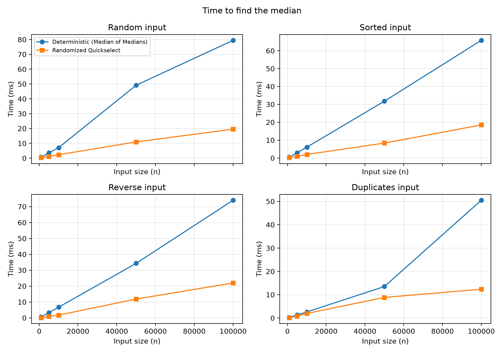

# Medians, Order Statistics, and Elementary Data Structures

**Terrence Tatum**
University of the Cumberlands
MSCS 532: Algorithms and Data Structures
November 22, 2026


## Introduction

This assignment looks at two groups of basic tools in computer science. The first group is selection, which means finding the kth smallest value in a list without sorting the whole thing. The second group is the elementary data structures that most programs are built on, such as arrays, stacks, queues, linked lists, and trees. Both topics come from the course textbook (Cormen et al., 2022). For each part I wrote the code from scratch in Python, tested it, timed it, and compared what I saw with what the theory predicts.

## Part 1: Selection Algorithms

### Implementation

Both algorithms live in `selection.py` and share the same interface. Each takes a list and a rank k, where k = 1 means the smallest value. Each one copies the list first, so the caller's data never changes. Both also check for an empty list and a k that is out of range before doing any work.

The randomized version follows the idea Hoare (1961) introduced with his Find algorithm. It picks a random pivot, splits the list around it, and keeps only the side that holds the answer. I wrote it as a loop instead of using recursion, so it never builds up a call stack.

The deterministic version follows the Median of Medians method from Blum et al. (1973), which Cormen et al. (2022) present as selection in worst case linear time. Instead of trusting luck, it builds a good pivot on purpose. The list is split into groups of five, each small group is sorted, and the middle value of each group is moved to the front. The algorithm then calls itself on those medians to find their median, and that value becomes the pivot. The core of that step looks like this:

```python
for start in range(lo, hi + 1, 5):
    end = min(start + 4, hi)
    _insertion_sort(a, start, end)          # sort one group of 5
    middle = (start + end) // 2
    # move this group's median up front so all the medians sit together
    a[lo + count], a[middle] = a[middle], a[lo + count]
    count += 1

# now find the median of those medians and use it as the pivot
target = lo + (count - 1) // 2
return _mom_select(a, lo, lo + count - 1, target)
```

Duplicates needed special care. A normal two way partition can behave badly when many values match the pivot, because those values keep landing on one side. I used a three way partition for both algorithms. It moves every value smaller than the pivot to the left, every larger value to the right, and keeps every copy of the pivot together in the middle. If k falls inside that middle block, the answer is found right away.

```python
while i <= gt:
    if a[i] < pivot:        # smaller values go to the left side
        a[lt], a[i] = a[i], a[lt]
        lt += 1
        i += 1
    elif a[i] > pivot:      # bigger values go to the right side
        a[i], a[gt] = a[gt], a[i]
        gt -= 1
    else:                   # copies of the pivot stay in the middle
        i += 1
```

My tests cover single items, lists where every value is the same, sorted and reversed lists, negative and decimal values, and every possible k on several lists. Every answer is checked against Python's `sorted` function.

### Time Complexity Analysis

The deterministic algorithm is linear in the worst case because of how good its pivot is. Half of the group medians are at least as large as the pivot, and each of those groups has at least three values that are at least that large. That gives roughly 3n/10 values on the large side, and the same count works on the small side. So after one partition, the part we keep has at most about 7n/10 + 6 values. The work can be written as

T(n) ≤ T(n/5) + T(7n/10 + 6) + cn

The first term finds the median of medians, the second handles the side we keep, and cn covers the grouping and partition. Since 1/5 + 7/10 = 9/10, which is less than one, the work shrinks by a fixed fraction every level, and the total adds up to O(n) no matter what the input looks like (Blum et al., 1973, Cormen et al., 2022). The three way partition only helps here, since values equal to the pivot are removed from the next round.

The randomized algorithm does not have that guarantee. If it kept picking the smallest or largest value as the pivot, each round would remove only one item and the total would be O(n²). That is very unlikely. A random pivot lands in the middle half of the list half the time, and when it does, at most three quarters of the list is left. On average it takes about two tries to get a good split, so the expected work forms a shrinking geometric series of roughly 2cn + 2c(3n/4) + 2c(9n/16) and so on. That series adds up to 8cn, which is O(n) expected (Cormen et al., 2022). Floyd and Rivest (1975) pushed this further with a sampling version that uses about n + min(k, n − k) comparisons on average, which shows how close randomized selection can get to the lower limit.

### Space Complexity and Overhead

Both functions use O(n) extra space for the working copy. If changing the caller's list were fine, both could run in place. Randomized Quickselect only adds a few index variables, so beyond the copy it uses O(1) space. Median of Medians calls itself on the list of medians, which is one fifth as long each time, so its stack depth is O(log n).

The bigger overhead for Median of Medians is time, not memory. Every pass sorts each group of five, swaps medians to the front, and runs a whole extra selection just to choose the pivot. Blum et al. (1973) bound the algorithm at no more than 5.4305n comparisons, which is a large constant compared to a lucky random pivot. Randomized Quickselect pays only for a random number and one partition per round. The tradeoff is that its running time changes from run to run.

### Empirical Results

I timed both algorithms on lists of 1,000 to 100,000 values in four orders. These were random, already sorted, reverse sorted, and a list with only ten different values. Each test looked for the median. I ran each case five times and kept the median time. All timings came from Python 3.14.8 using `time.perf_counter`. Table 1 shows the largest size, and Figure 1 shows every size.

**Table 1**
*Time to Find the Median of 100,000 Values*

| Input order | Median of Medians (ms) | Randomized Quickselect (ms) | Ratio |
|---|---|---|---|
| Random | 79.45 | 19.54 | 4.1 |
| Sorted | 65.81 | 18.51 | 3.6 |
| Reverse sorted | 74.03 | 21.98 | 3.4 |
| Many duplicates | 50.49 | 12.34 | 4.1 |

*Note.* Ratio is the Median of Medians time divided by the Randomized Quickselect time. Each value is the median of five runs.

**Figure 1**
*Running Time of Both Selection Algorithms by Input Size and Order*



*Note.* Data come from `results/selection_results.csv`.

The results line up with the theory. Both lines in Figure 1 rise in close to a straight line, which is what O(n) should look like. Median of Medians was between 3.4 and 4.1 times slower than Randomized Quickselect in every case. That gap is the constant factor from building the pivot, not a difference in growth rate. Sorted and reversed lists did not cause the random version to slow down. Those orders hurt quicksort style code that always picks the first or last value as the pivot, but a random pick does not care about the order. The duplicate heavy list was the fastest case for both because the three way partition often found the answer inside the block of equal values. For reference, Python's built in `sorted` function was faster than both in this setup. It runs in compiled C and finds already sorted runs quickly, which shows that a better growth rate does not always win when the competing code runs at a much lower level.

## Part 2: Elementary Data Structures

### Implementation

All of the structures are in `data_structures.py`. To act like a real fixed size array, the array based classes create a block of empty slots once and never call Python's own `append`, `insert`, or `pop` on it. All shifting and resizing is done by hand, so the cost of each step is easy to see.

`DynamicArray` supports get, set, append, insert, delete, and search. It doubles its size when full and halves it when only a quarter is used. `Matrix` stores a grid in one flat array, so the value at row r and column c sits at position r × cols + c, and it can add or remove whole rows and columns. `ArrayStack` uses the end of the array as its top. `ArrayQueue` uses a circular array, so the front index moves forward and wraps back to slot zero instead of shifting items. The key lines are:

```python
# enqueue: the back is "front plus size", wrapped around the end
back = (self._front + self._size) % len(self._data)
self._data[back] = value

# dequeue: take the front item, then move the front up one slot
value = self._data[self._front]
self._front = (self._front + 1) % len(self._data)
```

`SinglyLinkedList` keeps both a head and a tail pointer, so it can add to either end in constant time. It supports insertion at the front, the back, or any position, deletion by position or by value, search, traversal, and reversal. `LinkedStack` and `LinkedQueue` are built on top of it so the two designs can be timed side by side. For the optional part, `RootedTree` uses left child, right sibling links as described by Cormen et al. (2022). Each node has one link to its first child and one to its next sibling, so a node can have any number of children while only storing two links. There are 16 unit tests for these structures, including one that forces the circular queue to wrap around many times.

### Time Complexity Analysis

Table 2 sums up the cost of each operation. Doubling the array is what makes append and push O(1) amortized. A resize copies every item, but it only happens after the number of items has doubled, so the total copying across n appends is less than 2n. Tarjan (1985) describes this kind of averaging over a sequence of operations as amortized analysis. I shrink at one quarter full instead of one half so the array does not keep growing and shrinking when items are added and removed right at the boundary.

**Table 2**
*Time Complexity of Each Operation*

| Structure | Operation | Time |
|---|---|---|
| DynamicArray | get, set | O(1) |
| | append, pop at end | O(1) amortized |
| | insert or delete at index i | O(n − i) |
| | search by value | O(n) |
| Matrix | get, set | O(1) |
| | insert or delete a row or column | O(rows × cols) |
| ArrayStack | push, pop | O(1) amortized |
| ArrayQueue | enqueue, dequeue | O(1) amortized |
| SinglyLinkedList | insert or delete at front | O(1) |
| | insert at back (with tail pointer) | O(1) |
| | access, insert, or delete at index | O(n) |
| | search, traverse, reverse | O(n) |
| LinkedStack, LinkedQueue | push, pop, enqueue, dequeue | O(1) worst case |
| RootedTree | add child | O(number of children) |
| | depth of a node | O(height) |
| | preorder traversal | O(n) |

*Note.* n is the number of stored items. The amortized costs include the occasional resize.

### Arrays Versus Linked Lists for Stacks and Queues

Both designs give constant time stack and queue operations, but they get there in different ways. Arrays store items next to each other, so each item only needs one slot and the processor can read them quickly. The cost is that a resize every so often takes O(n) time all at once. Linked lists never resize, so every operation is O(1) in the worst case, but every item needs its own node with an extra link (Knuth, 1997). The queue is also where a careless array design falls apart. Removing from slot zero and shifting everything left turns each dequeue into O(n). The circular array fixes that.

Table 3 shows these tradeoffs in my timing results. I used 8,000 items and kept the median of three runs. I also used Python's `tracemalloc` module to measure a stack of 10,000 small integers. The array stack used about 44 bytes per item and the linked stack used about 79.

**Table 3**
*Array Based and Linked Structures With 8,000 Items*

| Job | Array based (ms) | Linked (ms) |
|---|---|---|
| Push then pop all items (stack) | 2.19 | 2.84 |
| Enqueue then dequeue all (circular queue) | 3.51 | 2.85 |
| Enqueue then dequeue all (shifting array queue) | 1,169.36 | n/a |
| Insert every item at the front | 1,137.92 | 1.71 |
| 1,000 reads at random positions | 0.08 | 58.47 |

*Note.* Data come from `results/structures_results.csv`.

**Figure 2**
*Running Time of Array Based and Linked Structures*


For plain stack and queue work, the two designs were close. The array stack was a little faster, and the linked queue was a little faster than the circular queue because it never had to resize or use the modulo step. The big gaps showed up when an operation did not fit the structure. Front inserts and shifting dequeues on an array grew with the square of n, which shows up as the steep curves in Figure 2. Random reads on a linked list grew with n because the list has to walk node by node to reach a position, while the array jumps straight to the slot.

### Practical Applications

Each structure has jobs it fits best. Arrays and matrices are the right choice when data has a fixed shape and gets read by position, such as images, spreadsheets, lookup tables, and the weights in a machine learning model. Stacks show up anywhere the most recent item matters first, such as undo in an editor, the back button in a browser, matching brackets in a compiler, and the call stack itself. The preorder traversal in my tree also uses a stack to avoid deep recursion.

Queues handle work in the order it arrives, such as print jobs, web server requests, and breadth first search in a graph. A circular array queue is a good fit for a fixed size buffer, such as streaming audio or a log that keeps only the latest events, because it uses a set amount of memory. Linked lists are a better fit when items are added and removed in the middle often and a pointer to the spot is already known. A common example is a least recently used cache, where a hash table points straight to each node so it can be moved to the front in constant time. Rooted trees model anything with a parent and child shape, such as file systems, company org charts, and the elements on a web page.

Selection algorithms have their own real uses. Medians are less affected by outliers than averages, so they work well for summarizing salaries, home prices, or network response times. In security monitoring, the 95th percentile of login or request times is a common baseline for spotting unusual activity, and selection finds that value without sorting every record. Randomized Quickselect is the better default in most of these cases because it is faster in practice. Median of Medians is worth the extra cost when an attacker could feed in data designed to slow the system down, or when a system has to promise a worst case time limit.

### Choosing Between Structures

When memory is tight or reads by position are common, an array based structure is the better choice because it stores less per item and reads any slot in constant time. When steady timing matters more than raw speed, such as in a system that cannot afford a sudden pause to resize, a linked structure is safer because it never copies everything at once. For ease of writing, an array stack is the simplest of all, and a circular queue only adds the wraparound math. Linked lists take more care, since every insert and delete has to keep the head and tail pointers correct, and that is where bugs are easiest to make. In the end, no single structure wins every case. The right choice comes from matching the structure to the operations the program does most.

## Conclusion

Both parts of this assignment showed that growth rate tells only part of the story. Median of Medians and Randomized Quickselect are both linear, but the randomized version was close to four times faster because it does far less work per round. In the same way, array and linked stacks share the same O(1) bounds, but their memory use and behavior on unusual operations are very different. Knowing the theory explains why the results came out the way they did, and running the code shows which choice actually holds up in practice.

## References

Blum, M., Floyd, R. W., Pratt, V., Rivest, R. L., & Tarjan, R. E. (1973). Time bounds for selection. *Journal of Computer and System Sciences, 7*(4), 448–461. https://doi.org/10.1016/S0022-0000(73)80033-9

Cormen, T. H., Leiserson, C. E., Rivest, R. L., & Stein, C. (2022). *Introduction to algorithms* (4th ed.). MIT Press.

Floyd, R. W., & Rivest, R. L. (1975). Expected time bounds for selection. *Communications of the ACM, 18*(3), 165–172. https://doi.org/10.1145/360680.360691

Hoare, C. A. R. (1961). Algorithm 65: Find. *Communications of the ACM, 4*(7), 321–322. https://doi.org/10.1145/366622.366647

Knuth, D. E. (1997). *The art of computer programming: Vol. 1. Fundamental algorithms* (3rd ed.). Addison Wesley.

Tarjan, R. E. (1985). Amortized computational complexity. *SIAM Journal on Algebraic and Discrete Methods, 6*(2), 306–318. https://doi.org/10.1137/0606031
